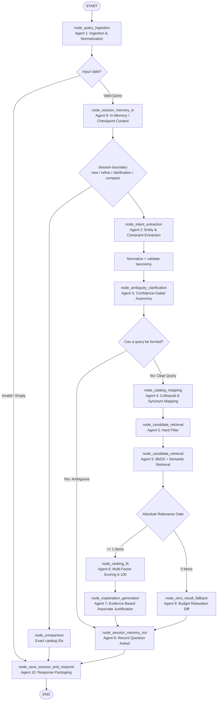

# ShopSense AI — Architecture & Multi-Agent Design

This document details the internal architecture, LangGraph state machine, agent contracts, state flow, and deterministic vs. LLM boundary for **ShopSense AI**.

---

## 1. Hybrid Agent Philosophy

A common anti-pattern in conversational commerce is delegating pure computation (e.g., "is price <= $1000", sorting items, calculating discounts) to an LLM. This leads to non-deterministic errors, budget hallucinations, and unnecessary API costs and latency.

ShopSense AI strictly separates concerns:
1. **Deterministic Logic**: Constraint evaluation, catalog indexing, mathematical scoring, unit conversion, and hard filtering.
2. **LLM Intelligence (Groq)**: Linguistic entity extraction, nuanced intent parsing, empathetic clarification questioning, and tailored natural-language explanations.

---

## 2. LangGraph State Machine Workflow

ShopSense AI uses **LangGraph `StateGraph`** with in-memory thread checkpointing (`MemorySaver`) to orchestrate all 10 agents.

---

## 3. Shared Graph State (`ShopSenseGraphState`)

The state machine shares a strongly typed `ShopSenseGraphState` dictionary across all nodes:

| State Key | Type | Description |
|-----------|------|-------------|
| `session_id` | `str` | Unique thread identifier isolating user sessions |
| `turn_id` | `int` | Dialogue turn counter |
| `original_user_message` | `str` | Raw input text or voice transcript |
| `input_source` | `str` | Input origin (`text` or `voice`) |
| `client_context` | `Dict[str, Any]` | Active browser tab URL and product context |
| `normalized_query` | `IngestedQuery` | Sanitized message with protected entities |
| `current_intent` | `ExtractedIntent` | Structured category, budget ceiling, use case, negations |
| `previous_intent` | `ExtractedIntent` | Carried over from prior turns for context merging |
| `session_boundary` | `str` | `new`, `refine`, `clarification_answer`, or `compare` |
| `session_memory` | `SessionContext` | Questions asked, confirmed constraints, shown items |
| `clarification` | `ClarificationDecision` | Confidence score, questions, and suggested options |
| `catalog_mapping` | `AttributeMappingResult` | Normalized catalog filters and applied synonyms |
| `retrieved_candidates` | `List[Product]` | Broad candidate pool from catalog |
| `eligible_candidates` | `List[Product]` | Candidates surviving strict hard constraints |
| `ranked_candidates` | `List[Tuple[Product, FitScore]]` | Scored items (0 - 100) with factor breakdowns |
| `recommendations` | `List[ProductRecommendation]` | Top recommendations with associate explanations |
| `fallback` | `FallbackSuggestion` | Budget relaxation diff and suggested alternatives |
| `data_source_status` | `str` | `ready`, `catalog_ready`, or `source_error` |
| `error_information` | `Optional[str]` | Error message if pipeline encountered non-recoverable error |
| `workflow_status` | `str` | Workflow stage tracker |
| `final_response` | `OrchestratorResponse` | Complete unified API response payload |

---

## 4. Graph Transitions & Routing Rules

1. **Query Normalization (`node_query_ingestion`)**:
   - Sanitizes text while preserving units (`16.5h`, `14"`), negations (`not leather`), and budget values (`₹8,000`, `$1,000`).
   - If empty/whitespace, branches directly to error response.
2. **Session Boundary Classification (`node_session_memory_in`)**:
   - Classifies each turn as a new request, refinement, clarification answer, or comparison.
   - Only refinement and clarification turns receive prior intent; new requests cannot inherit unrelated hard constraints.
   - Clarification answers enrich the existing intent; generic persona/use wording
     cannot replace the established product identity, category, or subcategory.
3. **Structured Extraction and Taxonomy Validation (`node_intent_extraction`)**:
   - Extracts structured criteria into `ExtractedIntent` via Groq LLM with deterministic regex fallback.
   - Normalizes catalog vocabulary such as `trail shoes` to `trail_running` and `hiking boot` to `hiking_boots`.
   - Unsupported categories remain hints and do not become hard filters.
4. **Confidence-Gated Clarification (`node_ambiguity_clarification`)**:
   - Computes structural completeness score (0.0 to 1.0).
   - Uses catalog coverage and product-type context to ask only high-impact questions, such as a laptop's primary use, when that missing choice can materially change ranking.
   - **Critical Rule**: If clarification is required, routes directly to `node_session_memory_out` and responds with the question. **Candidate retrieval is NOT triggered**.
   - On the next turn, user's answer is merged and workflow resumes.
   - Prevents asking identical questions repeatedly.
5. **Catalog Mapping (`node_catalog_mapping`)**:
   - Maps colloquial terms ("good for long walks" ➔ `walking`, "lightweight" ➔ `weight_kg <= 1.5`).
6. **Hard Filtering and Candidate Retrieval (`node_candidate_retrieval`)**:
   - Applies explicit category, budget, availability, exclusions, and verified-false feature checks before BM25 and semantic retrieval.
   - Unknown catalog attributes remain eligible and are surfaced as unknown; only verified false evidence rejects an explicit feature.
   - Builds the retrieval query from normalized product slots rather than arbitrary conversational text.
   - Exact category/subcategory matches provide a bounded relevance floor so
     semantically worded catalog descriptions are not lost before ranking.
   - If 0 items survive, branches to `node_zero_result_fallback`.
7. **Relevance Gate and Ranking (`node_ranking_fit`)**:
   - Applies an absolute relevance threshold before fit scoring.
   - Uses the same derived-feature resolver as hard filtering; unknowns are capped rather than treated as matches.
   - Applies the configurable `MIN_FIT_SCORE` threshold (default `50.0`) after ranking and before explanation generation; products below it cannot become primary recommendations.
   - Budget eligibility is evaluated independently of score; strict ceilings apply
     before ranking, including direct answers such as "my budget is INR 80,000".
8. **Explanation Generation (`node_explanation_generation`)**:
   - Produces evidence-based explanations highlighting verified features and honest trade-offs.
9. **Final Guard and Response Packaging (`node_save_session_and_respond`)**:
   - Revalidates every recommendation's hard constraints, relevance, eligibility, and fit threshold immediately before response generation.
   - Routes only to recommendation, clarification, fallback, or exact-ID comparison responses.
   - Fallbacks require a requested category or validated category hint and the same
     hard/relevance checks; ambiguous requests are never filled with arbitrary products.
   - Recommendation responses may include one catalog-driven complementary suggestion.
     The companion is selected from shared activity evidence, category diversity,
     availability, and budget checks; product pairings are not hardcoded.

## 7. Voice Input

The extension composer uses the browser Web Speech API when available. Speech is
transcribed into the same editable chat textarea before submission, so users can
review or correct it. Voice turns are sent with `input_source: "voice"`; unsupported
browsers show an explicit error and retain normal text input.

### Required invariants

1. A new product request never inherits unrelated hard constraints.
2. Explicit category and subcategory mismatches cannot pass.
3. Filtering and ranking use the same derived-feature resolver.
4. Tags satisfy a feature only when they are explicit catalog evidence.
5. Comparisons use exact catalog product IDs.
6. Fallbacks never silently remove required constraints.
7. Every returned product is revalidated immediately before response generation.

---

## 5. Safe Session Handling & Concurrency

- **LangGraph Checkpointing**: Built with `MemorySaver` using `{"configurable": {"thread_id": session_id}}`. State snapshots are persisted per session thread.
- **Thread Concurrency Locks**: Uses a thread-safe mutex dictionary per `session_id` to guarantee that concurrent requests on the same session do not clobber state.
- **Session Isolation**: Requests for separate session IDs run independently without leaking constraints or preferences.

---

## 6. Failure Resilience & Graceful Fallbacks

| Failure Scenario | Mitigation Strategy |
|------------------|---------------------|
| **Groq API Timeout / Network Drop** | Centralized in `llm_service.py` with 5.0s timeout; seamlessly falls back to `deterministic_extract_intent` without crashing. |
| **Invalid LLM JSON Output** | Caught by Pydantic validation; nullable or malformed optional booleans are normalized to safe defaults while prior session context remains available. |
| **Missing Catalog Attributes** | Unknown attributes classified as `UNKNOWN` (Rule #10), never assumed as matches. |
| **Zero Matching Candidates** | Branches to `ZeroResultFallbackAgent`, providing a +25% budget relaxation diff and alternative options. |
| **Malformed / Empty Input** | Rejected gracefully by `QueryIngestionAgent` with user-friendly guidance. |
