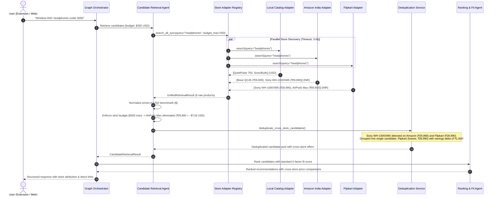

# ShopSense AI — Multi-Store Product Discovery & Cross-Store Comparison

## Overview

The Multi-Store Product Discovery & Comparison module extends ShopSense AI beyond single-store or open-page restrictions. When a shopper issues a request, the assistant searches, retrieves, normalizes, deduplicates, and ranks candidate products across multiple retail merchants into a single unified candidate pool.

---

## 1. Truthful Integration Status Table

> [!IMPORTANT]
> **Honesty & Provenance Rule (Rule #10)**: ShopSense AI never claims mock demonstration data is live store data. All integration states are strictly verified and audited.

| Store / Source | Integration Status | Supported Currencies | Authentication & Credentials Required | Rate Limit | Operational Notes |
| :--- | :--- | :--- | :--- | :--- | :--- |
| **Local Catalog** | **Live & Verified** | USD | None (local verified JSON catalog) | Unlimited | Guaranteed benchmark dataset across footwear, electronics, apparel, travel, and kitchen. |
| **Amazon India** (`amazon.in`) | **Mocked Demonstration** *(Live PA-API 5.0 Ready)* | INR (`₹`) | `AMAZON_PA_API_KEY`<br>`AMAZON_PA_API_SECRET`<br>`AMAZON_ASSOCIATE_TAG` | 1 TPS (Default) | In development mode, serves verified mock products with honest provenance (`is_sample_data: true`). Switches to live PA-API 5.0 when valid credentials are set. |
| **Flipkart** (`flipkart.com`) | **Mocked Demonstration** *(Live Affiliate API Ready)* | INR (`₹`) | `FLIPKART_AFFILIATE_ID`<br>`FLIPKART_AFFILIATE_TOKEN` | 5 TPS | Serves verified mock products with honest provenance (`is_sample_data: true`). Switches to live Flipkart Affiliate Search v1.0 when credentials are set. |
| **Active Tab (Extension)** | **Live & Verified** | USD, INR, EUR, GBP | Browser `activeTab` permission | N/A | Extracts candidate product from currently open product detail page when user clicks "Analyze" or "Compare". |

### Status Classification Definitions:
1. **Live and verified**: Fully authenticated with live production endpoints and actively verified response schemas.
2. **Configured but not verified**: Credentials provided in `.env`, but live API handshakes have not yet been validated.
3. **Mocked demonstration**: Authentic synthetic product records used for development and test suites. Transparently labeled with `provenance.is_sample_data = true` and `notes = "Mocked demonstration record"`.
4. **Not yet accessible**: Store integration requires partnership approval, whitelist enrollment, or credentials that are currently absent and mock fallback is disabled.

---

## 2. Retailer Access Methods, Terms, & Eligibility

### Amazon India (Product Advertising API 5.0)
- **Official Documentation**: [Amazon Associates PA-API 5.0 Documentation](https://webservices.amazon.com/paapi5/documentation/)
- **Eligibility Requirements**:
  1. Active Amazon Associates India account ([associates.amazon.in](https://associates.amazon.in)).
  2. Approved account with at least **3 qualifying sales** referred within the preceding 180 days.
  3. API Credentials generated from the Associates Portal (*Tools -> Product Advertising API*).
- **Environment Placeholders (`.env`)**:
  ```bash
  AMAZON_PA_API_KEY=your_access_key_here
  AMAZON_PA_API_SECRET=your_secret_key_here
  AMAZON_ASSOCIATE_TAG=your_tag-21
  AMAZON_REGION=eu-west-1
  AMAZON_HOST=webservices.amazon.in
  AMAZON_ENABLE_MOCK_FALLBACK=true
  ```
- **Terms & Restrictions**:
  - Request Signing: Requires AWS Signature Version 4 (SigV4).
  - Rate Limits: 1 request per second default, dynamically adjusted based on monthly referred sales.
  - Required Disclaimer: Product prices and availability must display a disclaimer stating they are accurate as of the date/time indicated and subject to change.
  - Scraping Prohibition: Automated web scraping of Amazon without PA-API credentials violates the Amazon Associates Operating Agreement.

### Flipkart (Affiliate API v1.0)
- **Official Documentation**: [Flipkart Affiliate API Documentation](https://affiliate.flipkart.com/api-docs)
- **Eligibility Requirements**:
  1. Registered account on the Flipkart Affiliate Platform ([affiliate.flipkart.com](https://affiliate.flipkart.com)).
  2. Active Affiliate ID and secure Affiliate Token.
- **Environment Placeholders (`.env`)**:
  ```bash
  FLIPKART_AFFILIATE_ID=your_affiliate_id_here
  FLIPKART_AFFILIATE_TOKEN=your_token_here
  FLIPKART_ENABLE_MOCK_FALLBACK=true
  ```
- **Terms & Restrictions**:
  - Rate Limits: 5 requests per second.
  - Data Freshness: Prices and stock status must be refreshed at least once every 24 hours.

---

## 3. Architecture & Unified Retrieval Flow



---

## 4. Key Engineering Features

### A. Common Store Adapter Interface (`BaseStoreAdapter`)
- Located in [backend/app/adapters/base.py](file:///c:/Users/Sejal%20Pc/Desktop/Shopsense/backend/app/adapters/base.py).
- Implements:
  - `search(query, category, budget_max, currency, limit)`: Returns normalized `StoreSearchResult`.
  - `get_product_details(product_id)`: Fetches full product facets.
  - `normalize_record(raw_record)`: Converts source payloads into standard [`Product`](file:///c:/Users/Sejal%20Pc/Desktop/Shopsense/backend/app/models/product.py#L51).
  - `get_status()`: Reports truthful [`StoreStatus`](file:///c:/Users/Sejal%20Pc/Desktop/Shopsense/backend/app/adapters/base.py#L22).

### B. Parallel Execution with Strict Timeout Resilience
- Located in [backend/app/adapters/registry.py](file:///c:/Users/Sejal%20Pc/Desktop/Shopsense/backend/app/adapters/registry.py).
- Dispatches async searches concurrently via `asyncio.gather(*tasks)` with a default 3.0s timeout per store.
- **Fault Tolerance**: If an external retailer times out or returns rate limit (HTTP 429) errors, the store is isolated and logged, and partial results from responding stores are returned smoothly without crashing.

### C. Multi-Currency Normalization
- Located in [backend/app/services/currency_service.py](file:///c:/Users/Sejal%20Pc/Desktop/Shopsense/backend/app/services/currency_service.py).
- Standardizes all store prices to a benchmark USD (`normalized_price_usd`) for fair filtering and ranking.
- Native currencies (`INR`, `USD`, `EUR`, `GBP`) and symbols (`₹`, `$`, `€`, `£`) are preserved for display and transparency.
- Never compares prices 1:1 across currencies without a valid exchange conversion.

### D. Cross-Store Deduplication & Savings Comparison
- Located in [backend/app/services/deduplication_service.py](file:///c:/Users/Sejal%20Pc/Desktop/Shopsense/backend/app/services/deduplication_service.py).
- Detects equivalent items across merchants using normalized brand and model identifiers.
- Groups merchant listings into `cross_store_offers`:
  - Selects the lowest-price merchant as primary recommendation.
  - Attaches direct clickable links to each store offer.
  - Computes exact savings delta (e.g. *"Available on 2 stores. Lowest price at Flipkart (₹28,990), saving ~$12.00 USD compared to Amazon India"*).

### E. Unified Ranking Engine Compatibility
- Reuses the existing deterministic multi-factor scoring formula in [backend/app/agents/ranking_fit.py](file:///c:/Users/Sejal%20Pc/Desktop/Shopsense/backend/app/agents/ranking_fit.py).
- Does not create conflicting ranking formulas for different stores.
- Strict budget matches are strictly enforced: items priced over budget receive `total_score = 0.0` and `budget_score = 0.0`.

---

## 5. Test Suite Verification

### Backend Pytest Suite (`python -m pytest`)
- **Total Tests**: 78
- **Passed**: 78
- **Failed**: 0
- **Duration**: 1.25s

| Test Module | Coverage & Scenarios Verified | Result |
| :--- | :--- | :--- |
| [test_store_adapters.py](file:///c:/Users/Sejal%20Pc/Desktop/Shopsense/backend/tests/test_store_adapters.py) | Local catalog search, Amazon India mock demonstration, Flipkart mock demonstration, disabled mock fallback (`not_configured`), malformed record handling. | ✅ PASS (5/5) |
| [test_multi_store_retrieval.py](file:///c:/Users/Sejal%20Pc/Desktop/Shopsense/backend/tests/test_multi_store_retrieval.py) | `GET /api/stores/status` integration table, `POST /api/stores/search` multi-store search, cross-store deduplication & savings delta, timeout resilience (`SlowMockAdapter`), error resilience (`FailingMockAdapter`), strict budget compliance with currency conversion. | ✅ PASS (6/6) |
| Legacy Agent & Workflow Tests | `test_agents.py`, `test_api_endpoints.py`, `test_catalog.py`, `test_extraction_context.py`, `test_health.py`, `test_workflow.py`. | ✅ PASS (67/67) |
